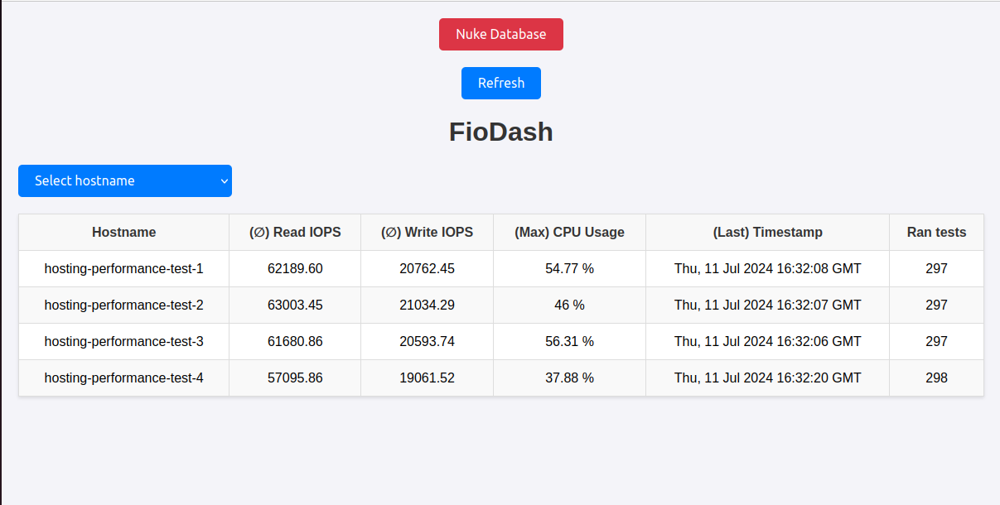

# FioDash


## Getting started

Simple tool collecting fio results from multiple servers. 



## Setup server collecting the results
Rename .env.template to .env and adjust the values

```
docker-compose up -d
```

## Setup servers sending results to FioDash
Use the following Cloud Init Config to run FioDash when the server starts up

```
#cloud-config
package_update: true
package_upgrade: true
packages:
- fio
- jq
- curl
package_reboot_if_required: true

write_files:
- path: /usr/local/bin/run_fio.sh
  permissions: '0755'
  content: |
    #!/bin/bash
     while true; do
       # Function to measure CPU usage
       measure_cpu_usage() {
       while true; do
         # Get CPU usage percentage
         usage=$(top -bn1 | grep "Cpu(s)" | sed "s/.*, *\([0-9.]*\)%* id.*/\1/" | awk '{print 100 - $1}')
         echo $usage >> /tmp/cpu_usage.log
         sleep 1
       done
       }
       # Start measuring CPU usage in the background
       measure_cpu_usage > /dev/null 2>&1 &
       cpu_usage_pid=$!

       # Run the fio test
       fio_output=$(fio --randrepeat=1 --ioengine=libaio --direct=1 --gtod_reduce=1 --name=fiotest --filename=testfio --bs=4k --iodepth=32 --readwrite=randrw --rwmixread=75 --runtime=20 --time_based --filesize=1M --output-format=json)

       # Stop the CPU usage measurement
       kill $cpu_usage_pid
       wait $cpu_usage_pid 2>/dev/null

       # Calculate the average CPU usage
       if [ -s /tmp/cpu_usage.log ]; then
         avg_usage=$(awk '{sum+=$1; count++} END {if (count > 0) print sum/count; else print "No data"}' /tmp/cpu_usage.log)
         avg_usage=$(printf "%.2f" "$avg_usage")
       else
         avg_usage="No data"
       fi

       # Create JSON payload
       json_payload=$(echo $fio_output | jq --arg hostname "$(hostname)" --arg cpu_usage "$avg_usage" '
       {
         hostname: $hostname,
         read_iops: .jobs[0].read.iops,
         write_iops: .jobs[0].write.iops,
         cpu_usage: $cpu_usage
       }')

       # Send JSON payload
       echo $json_payload | curl -X POST -H "Content-Type: application/json" -d @- http://10.83.199.10/update
       echo $avg_usage
       # Clean up
       rm /tmp/cpu_usage.log
     done
- path: /etc/systemd/system/run_fio.service
  permission: '0755'
  content: |
    [Unit]
    Description=Run Fio Script
    After=network.target

    [Service]
    ExecStart=/usr/local/bin/run_fio.sh
    Restart=always

    [Install]
    WantedBy=multi-user.target
runcmd:
# setup service running fio
- chmod +x /usr/local/bin/run_fio.sh
- systemctl daemon-reload
- systemctl enable run_fio.service
- systemctl start run_fio.service
```